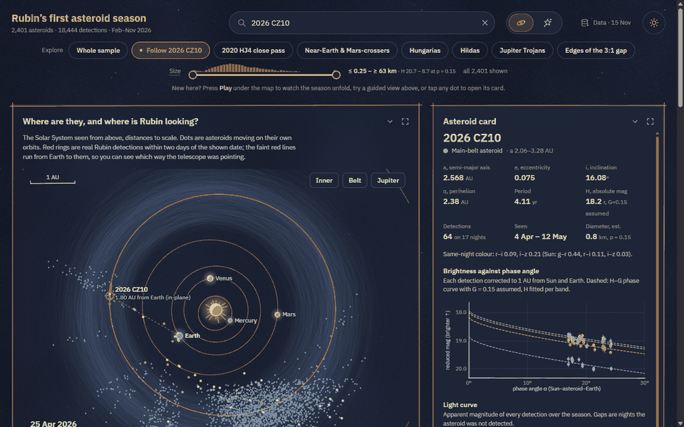
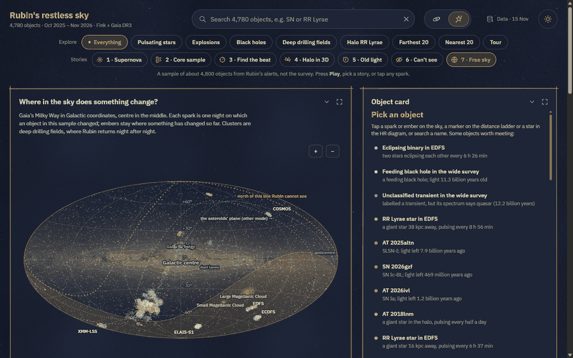

# Observatory · exploring public Rubin alerts

An interactive look at the first season of public alerts from the NSF–DOE Vera C. Rubin Observatory, as distributed by the [Fink](https://fink-broker.org) broker.

**Live:** https://observatory.noetx.com

> Independent project, not affiliated with or endorsed by the Vera C. Rubin Observatory.

There are two modes on one page:
- **Asteroids:** 2,401 known asteroids and 18,444 detections from 23 Feb to 15 Nov 2026. Their orbits run live in the browser, with orbital-element space, light curves, colours, cadence and image stamps.
- **Stars & beyond:** 4,780 variable stars, supernovae and quasars from the same alert stream, placed on Gaia's Milky Way and on a distance ladder. Six guided stories add hands-on tools: a period dial, a light-travel clock, a 3D halo and a horizon chart.





## What the views show

### Asteroid mode

- **Where are they?** A top-down map of the Solar System, to scale.
  - Each asteroid moves on its two-body Keplerian orbit; Kepler's equation is solved per frame.
  - Planets come from JPL's approximate elements.
  - Rings mark real detections within ±2 days, with lines of sight from Earth.
- **How does Jupiter sculpt the belt?** Semi-major axis against eccentricity or inclination, with the Kirkwood gaps and Jupiter's resonances.
- **What are they made of?** Colours r − i and i − z from exposures in two filters taken minutes apart, compared with the Sun.
- **When was Rubin observing?** Alerts per night from Fink statistics, with gaps shown as gaps.
- **Stamps:** science − template = difference for one alert. Any asteroid's latest stamps can be fetched on demand.
- **Asteroid card:** orbital elements, an H–G phase curve with G = 0.15 assumed unless SSOFT constrains it, a light curve, and an estimated diameter (D = 1329 km / √p × 10^(−H/5), with the albedo by class).
- **Size filter:** a two-handle slider on estimated diameter.
- **Live updates:** the Data button fetches newer alerts straight from the Fink API into IndexedDB. Bundled data is never changed.

### Stars & beyond mode

- **Sky:** Gaia DR3's Milky Way in Galactic coordinates, with nightly sparks for the sample's alerts.
  - A soft disc marks the sky above Cerro Pachón at local midnight.
  - The map zooms with fine Gaia tiles and IAU star names.
  - Stars are drawn as glows coloured by their measured colour (Gaia BP − RP, or g − r), with thin spikes on the brightest. Supernovae flare with an expanding ring and fade; AGN flicker by their light-curve scatter.
  - The 427 objects with a known period pulse at that period, sped up by one shared factor (1 day = 2 s by default) so relative rhythms are real. The shape comes from each star's folded light curve where it has enough points, otherwise from its family's average. Pulses faster than 3 per second are shown steady with a ring, and reduced motion turns pulsing off.
- **Season ribbon:** Fink alerts per night by filter, as a scrubber.
- **Distance ladder:** 1 pc to 10 Gpc, with the marker style showing how each distance was measured.
- **Census:** objects per family, and how they were selected.
- **HR diagram:** 1.34 M nearby Gaia stars as a density image tinted by colour, with approximate temperature and luminosity axes, the instability strip and the Sun, behind the sample's stars that have a good parallax. Zoom and pan like the sky.
- **Live updates:** the same Data button checks the sample's objects for new alerts, can add new objects from the build script's Fink tag and class queries, and refreshes the nightly statistics. Stored in its own IndexedDB database; the bundled data is never changed.
- **Stories:**
  1. a Type Ia supernova as a standard candle;
  2. a core sample through one deep field;
  3. finding a binary's period;
  4. the halo in 3D;
  5. light older than the Sun;
  6. what Rubin can't see.

Each step drives the map, the stage and the timeline, and ends on one number with a "how sure are we?" line.

### Honesty notes

- These are samples of the alert stream, not the survey. Proportions reflect how the samples were drawn.
- Orbits are two-body ellipses fixed at each asteroid's last detection; far from that date the positions are extrapolations.
- Absolute magnitudes use no K-correction and no extinction correction.
- Photometric redshifts are rough.
- Class labels are catalogue crossmatches and classifier guesses.

## Data sources, credits and licences

| Source | Used for | Licence and credit |
|---|---|---|
| Vera C. Rubin Observatory alerts via **Fink** (api.lsst.fink-portal.org) | asteroid alerts, SSOFT, stars and transients, statistics, stamps, forced photometry | Rubin alerts are world-public. Fink: Möller et al. 2021, MNRAS 501, 3272. Crossmatch labels from AAVSO VSX, SIMBAD (CDS), the Transient Name Server, Mangrove and Legacy Surveys DR8. |
| **ESA Gaia DR3** (Gaia Archive TAP) | Milky Way density, bright stars, HR diagram, crossmatch, parallaxes, periods, zoom tiles | CC BY-SA 3.0 IGO. Gaia Collaboration, Vallenari et al. 2023, A&A 674, A1; distances from Bailer-Jones et al. 2021, AJ 161, 147. "This work has made use of data from the European Space Agency (ESA) mission Gaia, processed by the Gaia Data Processing and Analysis Consortium (DPAC). Funding for the DPAC has been provided by national institutions, in particular the institutions participating in the Gaia Multilateral Agreement." |
| **SDSS DR16** via the GAVO Data Center | spectroscopic redshifts and classes | Ahumada et al. 2020. "Funding for the Sloan Digital Sky Survey IV has been provided by the Alfred P. Sloan Foundation, the U.S. Department of Energy Office of Science, and the Participating Institutions." |
| **IAU Catalog of Star Names** (WGSN, compiled by E. Mamajek) | star names at high zoom | CC BY |
| **JPL approximate Keplerian elements** (E. M. Standish) | planet positions | public JPL documentation |
| **IBM Plex Sans** | typeface | SIL Open Font License 1.1 |

- **Code:** MIT; see [LICENSE](LICENSE).
- **Data files** in `site/data/` are derived from the sources above and stay under their licences; files derived from Gaia are CC BY-SA 3.0 IGO. See [site/data/LICENSE.md](site/data/LICENSE.md).
- RR Lyrae distances use M_G = 0.63 (Muraveva et al. 2018). Cosmology is flat ΛCDM with H0 = 70 and Ωm = 0.3.

## Run locally

The site is static: ES modules and JSON, with no build step. It needs a local web server because modules and `fetch` do not work from `file://`.

```
cd site
python -m http.server 8000
```

Then open http://localhost:8000. URL options:
- `?mode=stars` opens the stars mode;
- `&chapter=sn|core|beat|halo|old|cant` opens a story, and `&beat=N` a step in it;
- `?sel=2026 CZ10` and `&obj=<diaObjectId>` select an object;
- `?theme=light|dark` sets the theme;
- `?still` disables autoplay.

## Rebuild the data

Raw downloads go to `data/`, which is not committed. The scripts are resumable and skip files that already exist. All of them take `--help`.

```
python scripts/fetch_asteroids.py 2000
python scripts/build_asteroids.py
python scripts/fetch_stars.py
python scripts/build_stars.py
python scripts/build_stars.py --tiles
node scripts/check_site.mjs
```

- `fetch_asteroids.py` fetches SSOFT and the alerts for 2,000 more asteroids.
- `build_asteroids.py` writes `site/data/asteroids.json`. It expects the original sample files in `data/` as well.
- `fetch_stars.py` fetches the Fink and Gaia data for the stars mode into `data/stars-<date>/`.
- `build_stars.py` writes `site/data/stars.json`; with `--tiles` it writes `site/data/stars-tiles.json`.
- `check_site.mjs` scans the repository: no Cyrillic text, no unfinished-work markers, no console logging, and every file the page references exists.

Refetching changes the numbers. Data versions are pinned with a `?v=` query in `site/js`.

## Architecture

- **`site/index.html`** holds one shared shell: header, search, mode switch, theme and the panel components. `style.css` uses design tokens for night and day paper.
- **`site/js/`** contains the ES modules:
  - `kit.js`: tokens, the pencil drawing primitives, canvases, tooltips, panels, theme and URL helpers;
  - `main.js`: search, mode switching and start-up;
  - `asteroids.js`: the asteroid mode;
  - `net.js`: the polite Fink client (retries, backoff, concurrency) and the IndexedDB wrapper;
  - `sync.js` and `starsync.js`: live updates for each mode, kept in separate IndexedDB databases;
  - `datapanel.js`: the shared Data dialog that both modes plug into;
  - `stars.js`: the sky, ladder, ribbon, census and HR diagram;
  - `starlight.js`: star colours, glow sprites and the pulse shapes;
  - `story.js`: the stories and toys.
  
  The stars modules and their data load only on the first switch.
- **`site/data/`** holds the JSON built by `scripts/`.
- **Deploy:** `.github/workflows/deploy.yml` runs the checks and publishes `site/` to Cloudflare Pages when the Cloudflare secrets are set.
- **Globals:** only `window.Observatory` exists (performance counters and test hooks).

## Performance

Everything is Canvas 2D. Static layers are rendered once per size, zoom and theme and then cached: planet orbits, the Gaia Milky Way, the ladder, the ribbon and hand-drawn frames. Each frame draws only moving points and sprites.

Measured in headless Chrome over 6 s of play:

| Mode | Setting | Draw time per frame | Frame interval |
|---|---|---|---|
| Asteroids | 1440×900 | 1.7 ms median, 2.3 ms p95 | 16.7 ms |
| Stars | 1440×900, busiest nights | 1.3 ms median, 2.6 ms p95 | 16.7 ms |
| Stars | phone 412×915 at DPR 2, CPU slowed 4× | 4.2 ms median | 16.7 ms |

Zoom re-renders the Milky Way at the new scale about 180 ms after the gesture settles. The period dial refines a snap with a 4-harmonic fit, about 30 ms once.

Animation pauses in hidden tabs and respects `prefers-reduced-motion`.
