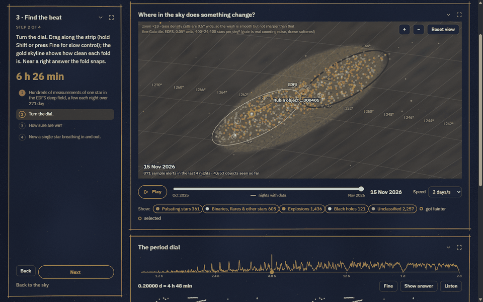

# Look up · Observatory

An interactive observatory: the first season of public alerts from the NSF–DOE Vera C. Rubin Observatory, as distributed by the [Fink](https://fink-broker.org) broker, the oldest light and its dark-matter shadow, and the Earth's own aurora, space weather and lightning.

**Live:** https://observatory.noetx.com

> Independent project, not affiliated with or endorsed by the Vera C. Rubin Observatory.

There are four modes on one page:
- **Stars & beyond** (the default): 4,780 variable stars, supernovae and quasars from the alert stream, placed on Gaia's Milky Way and on a distance ladder. Six guided stories add hands-on tools: a period dial, a light-travel clock, a 3D halo and a horizon chart. "Tonight" picks bright new transients to observe from your own place.
- **Asteroids:** 2,401 known asteroids and 18,444 detections from 23 Feb to 15 Nov 2026. Their orbits run live in the browser, with orbital-element space, light curves, colours, cadence and image stamps.
- **Dark matter:** the Planck CMB under a lensing magnifier, the 10,040 ACT DR6 clusters and Rubin's supernova-like alerts, with two meters that ask whether the explosions follow the dark matter yet.
- **Earth:** the Earth at night on a WebGL globe with both polar caps, the OVATION aurora model, space weather from NOAA live in the browser, and last night's lightning from the GOES-East and GOES-West Geostationary Lightning Mappers and the Meteosat MTG Lightning Imager.

The modes are floors of one sky, and the **altitude ladder** on the left (a strip under the search box on narrower screens) is how you move between them: a log scale of distance from the ground to the oldest light, which shows where you are and what is selected.




## What the views show

### Asteroid mode

- **Where are they?** A top-down map of the Solar System, to scale.
  - Each asteroid moves on its two-body Keplerian orbit; Kepler's equation is solved per frame.
  - Planets come from JPL's approximate elements.
  - Rings mark real detections within ±2 days, with lines of sight from Earth.
- **How does Jupiter sculpt the belt?** Semi-major axis against eccentricity or inclination, with the Kirkwood gaps and Jupiter's resonances.
- **What are they made of?** Colours r − i and i − z from exposures in two filters taken minutes apart, compared with the Sun.
- **When was Rubin observing?** Alerts per night from Fink statistics, with gaps shown as gaps.
- **Stamps:** science − template = difference for one alert. Any asteroid's latest stamps can be fetched on demand.
- **Asteroid card:** orbital elements, an H–G phase curve with G = 0.15 assumed unless SSOFT constrains it, a light curve, and an estimated diameter (D = 1329 km / √p × 10^(−H/5), with the albedo by class).
- **Size filter:** a two-handle slider on estimated diameter.
- **Live updates:** the Data button fetches newer alerts straight from the Fink API into IndexedDB. Bundled data is never changed.

### Stars & beyond mode

- **Sky:** Gaia DR3's Milky Way in Galactic coordinates, with nightly sparks for the sample's alerts.
  - A soft disc marks the sky above Cerro Pachón at local midnight.
  - The map zooms with fine Gaia tiles and IAU star names.
  - Stars are drawn as glows coloured by their measured colour (Gaia BP − RP, or g − r), with thin spikes on the brightest. Supernovae flare with an expanding ring and fade; AGN flicker by their light-curve scatter.
  - The 427 objects with a known period pulse at that period, sped up by one shared factor (1 day = 2 s by default) so relative rhythms are real. The shape comes from each star's folded light curve where it has enough points, otherwise from its family's average. Pulses faster than 3 per second are shown steady with a ring, and reduced motion turns pulsing off.
- **Season ribbon:** Fink alerts per night by filter, as a scrubber.
- **Distance ladder:** 1 pc to 10 Gpc, with the marker style showing how each distance was measured.
- **Census:** objects per family, and how they were selected.
- **HR diagram:** 1.34 M nearby Gaia stars as a density image tinted by colour, with approximate temperature and luminosity axes, the instability strip and the Sun, behind the sample's stars that have a good parallax. Zoom and pan like the sky.
- **Live updates:** the same Data button checks the sample's objects for new alerts, can add new objects from the build script's Fink tag and class queries, and refreshes the nightly statistics. Stored in its own IndexedDB database; the bundled data is never changed.
- **Stories:**
  1. a Type Ia supernova as a standard candle;
  2. a core sample through one deep field;
  3. finding a binary's period;
  4. the halo in 3D;
  5. light older than the Sun;
  6. what Rubin can't see.

Each step drives the map, the stage and the timeline, and ends on one number with a "how sure are we?" line.

### The ladder: everything above your head, floor by floor

The ladder is one log axis of distance, from 1 km at the bottom to the cosmic microwave background at the top (23.7 decades). It is also the mode switch: one radiogroup, drawn as a 64 px rail on screens 1,200 px and wider and as a strip in the header below that.

- **Distances.** Everything is in km on the axis; the labels switch units as they climb: km up to 10 million km, then AU, light-years from 0.05 ly, and Gyr of light from a billion light-years.
  - **Main axis: light travel.** For distant objects the axis shows how long their light has been travelling (lookback time × c), because that is the light reaching you.
  - **The fork: comoving distance.** Above z ≈ 0.03 (about 0.4 billion years of light) the line forks. The left branch stays light travel; the right branch is the comoving distance, where that matter is now. Hairlines join equal redshifts (z = 0.1, 0.5, 1, 2 and 1090). At the CMB the two read 13.5 billion years of light and about 44 billion light-years now.
  - **Cosmology:** flat ΛCDM with H0 = 70 km/s/Mpc, Ωm = 0.3 and Ωr = 8.4 × 10⁻⁵, the same as the rest of the site (`site/js/cosmo.js`, checked by `scripts/test_cosmo.mjs` in CI). The often quoted 46 billion light-years to the CMB uses Planck's H0 = 67.7; with H0 = 70 it is 44.
- **Floors:** lightning 10–15 km, aurora 100–300 km, the solar wind at L1 (1.5 million km), asteroids 0.02–6 AU from Earth, variable stars 30–100,000 ly, supernovae and AGN 0.1–11 Gyr of light, galaxy clusters 0.7–10 Gyr of light, the CMB. Landmarks (the Moon, Voyager 1, one light-year, the Galactic centre, Andromeda) give the empty stretches a sense of scale; the empty stretches are left empty.
- **Marks.** A gold bar spans the distances of the objects in front now (5th to 95th percentile), a gold chevron marks the selected object, and a ring on the comoving branch marks where a cosmological selection is now. The chevron's style says how the distance is known: filled for measured (Gaia parallax, spectroscopic redshift, a fitted orbit), open for indirect (standard candles, host galaxies, cloud membership, catalogue redshifts), dotted for weak (photometric redshift), open with a dashed tick for typical values and models (storm tops, the aurora shell). With nothing selected the readout starts with "≈".
- **Peek and sheet.** Hovering or focusing the rail opens a labelled copy of the scale beside it, with the selection's light travel, redshift and comoving distance. At 1,760 px and wider the labels stay on the rail. On the strip, tapping the track opens the same ladder as a sheet.
- **Motion.** Switching modes, the chevron climbs or descends in log space over 600 ms + 35 ms per decade (at most 1.4 s), the floors it passes light up and the readout counts with changing units. The page switches at once; the climb never delays it. With reduced motion the marker cross-fades in 150 ms.
- **Keyboard.** Arrow keys follow the picture: Up goes to a higher floor on the rail, Right on the strip; Home and End go to the ground and the CMB. The position is announced only when the mode or the selection changes.
- **The contract.** Each mode module exports `ladder()`, which returns plain km: `{ band, view, also, rest, sel: { km, comovingKm, z, label, how, words, note } }`. `view` and `also` are the gold bar's segments (Earth adds L1 when its space-weather strip is in use or Live; Dark matter adds the CMB); `rest` is where the chevron sits with nothing selected. Modes dispatch a `ladder` event, at most four times a second, when either changes.

### The showcase: who is in front

Every mode shows its most unusual objects in front and the rest as a soft haze, so the maps stay readable at full sample size.
- `scripts/build_showcase.py` scores every object nightly and writes `site/data/showcase.json`. Each object gets 0–1 per component; its best three count in full, half and quarter, plus a small boost for being new (score = 100 × (v₁ + ½v₂ + ¼v₃ + 0.15 fresh) / norm). A fifth of the front places go to objects seen in the last three data nights, and no family takes more than 40%.
  - Stars: rarity of the class here, outburst size, brightness for a small telescope (g or r only), distance and period extremes, a TNS spectrum, and labels that disagree.
  - Asteroids: class (NEOs, and PHAs from a brute-force MOID), orbit shape, the closest pass in the next 90 days, size and detection extremes.
  - Dark matter: mass percentile, the SN-like excess over the cluster's own surroundings, Rubin coverage, and a fresh alert inside.
- In the browser, the front set is the top 120 (stars, dark matter) or 100 (asteroids), half that on phones, growing as N₀ × zoom^1.5 when zoomed in, with at most two per 24 px cell. Weights ease over 250 ms and "Show all" ripples down the ranking. The haze is a half-resolution, blurred layer drawn at alpha 0.35 per object (source-over, so dense deep fields do not burn out).
- Each card says why an object is there in chips, and the stars card shows its score.

### Tonight

The stars mode has a "Tonight" view for anyone with a 20–50 cm telescope.
- `scripts/build_tonight.py` runs nightly: Fink's bright-transient tags over the last 30 days, two or more good detections, |b| ≥ 15°, no pre-2025 TNS name and no catalogued star, then a 2″ Gaia DR3 cone (GAVO mirror, ESA fallback) that removes the variable stars and AGN, which are most of the candidates. It stores each target's light curve and a packed 12′ Gaia finder field.
- A target counts as tonight only if Rubin saw it within the last 7 days. The card lists them with the hours each spends above 30° in the dark from the viewer's place, an altitude chart in the place's clock time, the light curve against what a 30–50 cm scope reaches, a finder chart (also as a PNG) and report links.
- The place comes from the browser's time zone, an opt-in geolocation rounded to 0.5°, or a list of 30 places. It is kept only in `localStorage` and never sent anywhere or put in the URL.
- `site/js/skycalc.js` ports the sky calculations (GMST, a low-precision Sun, altitude); `scripts/test_skycalc.mjs` checks it against the Python reference for five sites in CI.

### Dark matter mode

- **The oldest light:** the Planck SMICA map of the cosmic microwave background, in Galactic coordinates, drawn as a muted warm and cool weave in a WebGL shader.
- **The lens:** under a movable gold lens the CMB is shifted by the lensing deflection reconstructed by Planck PR4, d = ∇φ with φ_ℓm = 2 κ_ℓm / ℓ(ℓ+1), amplified from ×1 to ×300. At ×1 the shift is the true one, a few arcminutes, and invisible. "Show the shadow" fades into the convergence κ itself, the projected mass.
- **Clusters:** the 10,040 ACT DR6 SZ clusters, scaled up from their θ500. All of them form a faint static lace; the 120 heaviest and busiest (60 on a phone) are breathing gold rings in front, doubled when unusually many SN-like alerts sit inside. Inside the lens every ring in view shows (at most 150). The card shows redshift, M500c, the SN-like alerts inside R500 and how many the 3–6 R500 ring predicts.
- **Confident supernovae:** up to 40 SN-like objects stay marked after their spark: TNS-classified supernovae first, then `most_likely_sn` and `extragalactic_new_candidate` objects that do not look like stars, by number of tags, then by recency.
- **Explosions:** 146,350 Fink `most_likely_sn` objects appear as sparks on the night they were first seen. The Data button can fetch newer ones.
- **Meters:** κ stacked at 76,726 SN-like alerts gives −0.2σ against 300 rotated skies (b = −0.8 ± 3.5) over about 1,319 deg², the number of HEALPix nside-64 cells (0.84 deg² each) that hold a used object. The first build quoted 2,351 deg² from the analysis script, which grouped RING-ordered pixels into strips rather than cells and so overstated the area; the meter itself never used that number, and the cluster catalogue does not touch the lensing test; ACT clusters through the same pipeline give +7.1σ. SN-like alerts inside ACT DR6 clusters: 324 seen against 295.0 expected over 527 of the 7,801 southern clusters, +0.9σ. A dashed needle keeps the DR5 value under the same definition, 144 against 125.5 over 228 of 4,195 clusters, +1.1σ (before 23 Nov 2026 the DR5 meter counted starlike objects too and read 201 against 179.4, 0.9σ). The design prototype read 0.0σ on DR6 (227 against 226.6 over 363 clusters) because it used a different selection, an older 64,473-object snapshot; the live meter uses every SN-like object Fink has tagged since. One definition for the cluster meter: `most_likely_sn` objects that are not starlike (Legacy Survey p_star ≤ 0.5), |b| > 20°, counted inside R500 = θ500 against a 3–6 R500 annulus, over clusters with any object within 6 R500, with a 2,000-draw bootstrap over those clusters (seed 7). Forecasts: 3σ around late 2027 for both tests (about 0.8 years of full southern coverage for DR6).
- Without WebGL the map is drawn once on a 2D canvas, without the lens.

### Earth mode

- **The globe.** An orthographic globe in the middle and the two polar caps either side, looking straight down on each pole with noon at the top and 45° at the rim, so both aurora ovals are always in view. Drag turns the globe, the wheel or a pinch zooms at the pointer from 1× to 12×, + and − zoom, 0 resets, arrows turn it by 5°. A click on a cap flies the globe over that pole. One WebGL shader draws the globe and both caps: night and day sea and land, Black Marble city lights on the night side, a gold coastline from the land mask, a 30° graticule, the gold terminator at Sun altitude 0°, the coverage hatch and two aurora shells. Without WebGL the globe is drawn once per view on a 2D canvas, without the shells. The caps fade out once the zoomed globe would cover them.
- **City lights** are NASA's Black Marble 2016 composite (lights = (R − 0.55·B)·1.6, gamma 0.75, which keeps the yellow-white city lights and drops the blue moonlit land), drawn in gold at night and in ink on day paper. They are not tonight's lights.
- **Aurora.** OVATION Prime is a model: the chance, per 1° × 1° cell, that aurora is overhead within the hour, computed from the solar wind at L1 about 30–90 minutes ahead. It is drawn on two shells, about 110 km (green, OI 557.7 nm) and 220 km (red, OI 630 nm, only where the oval is strong) above the surface, true to scale, so the glow pokes past the limb and brightens toward it as in photos from orbit. Live shows the newest run from NOAA, refreshed every 10 minutes. For the hours of the nightly window the site keeps only the run current at build time and turns it with the Sun (the oval is fixed to the Sun while the Earth turns under it); the map and the card say so. There is no hourly aurora log.
- **Lightning.** The nightly refresh aggregates the 24 hours to an hour before the build from GOES-19 (GOES-East) and GOES-18 (GOES-West) GLM L2 flash files on NOAA's open S3 buckets, about 8,640 files and 2 GB a night, and from the MTG-I1 Lightning Imager (LI-2-LFL, 144 ten-minute products) through the EUMETSAT Data Store. Only quality-flag-0 GLM flashes are kept; scale factors and `_Unsigned` are honoured; flash areas are converted to km². Where satellites overlap, each flash is kept from the one whose sub-satellite point is nearer, so no flash is counted twice. A flash is stored in 7 bytes (latitude, longitude, time, energy class; the class is the flash's energy percentile among that instrument's flashes of the day).
- **Level of detail: a rate budget.** About 15 flashes a second fall in GLM's view alone, about 13,900 a second of playback at 15 min/s. The map draws about 30 a second (18 on a phone): the stride is the real rate in view divided by that budget, applied to a 1-in-128 sample (`earth-lightning.json`; 1 in 256 or sparser on nights with more than about 1.7 M flashes, so the file stays within its budget) or, from zoom 3, to the 1-in-8 tiles of the area in view (`earth-tiles/`, loaded lazily and decoded in idle-time chunks; dense tiles are split into quarters). The pill says how many are drawn ("Drawing 1 in 384 of 1.26 M flashes"); the violet haze is the hourly 1° density of all flashes, so no storm disappears. A flash glows for 350 ms of wall time (30% with a second stroke) and leaves an ember for an hour of data time.
- **Storm cells** are 8-connected clusters on a 0.25° grid with at least 20 flashes in an hour, linked hour to hour within 150 km, and named from Natural Earth countries and seas ("Storm over northern Argentina", "Storm over the North Atlantic").
- **Time.** The scrubber covers the nightly window; the part after it is hatched because lightning arrives only with the next nightly update. The gold ring at the right end is Live (key L). Play loops the window with the 1.6 s wrap fade. ← → step 10 minutes, Shift an hour, Space plays.
- **Space weather** comes live from NOAA SWPC in the browser (its CORS is open): solar wind speed and density and Bz from the active L1 spacecraft (SWFO-L1 today, with ACE and IMAP as backups, read from the data), planetary Kp, GOES X-rays and flares, the NOAA R, S and G scales and the OVATION hemispheric power. The nightly build keeps a copy of the window as the fallback. Each lane carries a provenance mark: a green dot for live, a hollow dot for the nightly copy, a gold diamond for model values. The dashed gold line marks the solar wind measured at L1 that reaches Earth at the map's time. Requests go only while the Earth view is open and the tab is visible, at most once a minute per product, with backoff on errors; the Data panel can turn them off. Your place, used for "Aurora from …", comes from the same browser storage as Tonight and is never sent anywhere.
- **Clouds (opt-in).** The Clouds button over the map adds today's clouds. Nothing is fetched until it is pressed; the choice is remembered in this browser. Five infrared images (about 512 px each, EPSG:4326) come straight from the browser: Meteosat MTG (`mtg_fd:ir105_hrfi`) and Meteosat IODC (`msg_iodc:ir108`) from EUMETView, and GOES-East, GOES-West and Himawari Band 13 clean infrared from NASA GIBS. They are blended into one 1024 × 512 equirectangular layer with seams feathered by each satellite's view angle (full weight to 60°, none beyond 78°), and recoloured in the globe shader: the infrared brightness becomes the opacity of a soft paper-toned haze, the coldest cloud tops turn faintly gold, city lights show through the gaps, and lightning and aurora stay on top. GIBS serves its infrared in an enhanced colour palette, so the coldest tops are read back from its hues. The images are kept in the browser's Cache Storage for 8 hours; Refresh fetches a new set. The layer says "Clouds as of HH:MM UTC, not the map's time" and names any satellite that did not load. Credit: infrared imagery recoloured for this site, based on EUMETSAT Meteosat data, NOAA GOES and Himawari (Japan Meteorological Agency), via EUMETView and NASA GIBS. We acknowledge the use of imagery provided by services from NASA's Global Imagery Browse Services (GIBS), part of NASA's Earth Science Data and Information System (ESDIS). No endorsement by any of them is implied.
- **Coverage, said out loud.** Hatched areas have no open lightning data: Asia, Australia and the Indian Ocean (and Europe and Africa on a night the Lightning Imager could not be fetched). The Regions panel and the card say the same. Blitzortung is not used: its terms rule out exactly this kind of public live visualisation.
- **Easter egg.** While the map plays, every 1000th lightning flash drawn on screen is followed by a transient luminous event high above the storm: usually a red sprite (a jellyfish-shaped glow at 50–90 km, with blue tendrils below, normally lasting 10–100 ms) and, after the strongest flashes (top 10% of that day's flash energies), an ELVES ring (a red halo at about 90 km that expands to hundreds of kilometres in under a millisecond). They are illustrations, not detections: no satellite on this page sees them, their timing is stretched to about 0.8 s and their height exaggerated so they read at globe scale, and they are drawn side-on near the limb and from above near the centre. The page deliberately does not label them. With reduced motion they appear as still glyphs. The only trace is the test hook `Observatory.earth.eggs`.

### Data health

The Data panel opens with a health check that the nightly refresh writes to `site/data/health.json` (`scripts/build_health.py`). It tells apart four situations that otherwise all look like "no new data":

- **Rubin silent.** Neither Fink (its nightly `statistics` endpoint) nor ANTARES (an independent broker, queried for its newest Rubin alert) has alerts after the same night. The pause is upstream: weather or a technical stop at the telescope. The panel links to Rubin's live status page for the reason; that page reads a private API, so the site does not scrape it.
- **Broker lag.** ANTARES has Rubin alerts at least two nights newer than Fink. Rubin is observing, and this site, which reads Fink, waits.
- **Pipeline failure.** A refresh step failed, or its output did not parse and the committed file was deployed instead. The affected parts show the previous run's data.
- **Behind.** Fink has newer nights than a mode on this page, without a failure; the refresh ran out of its time budget and catches up next run.

The sparkline shows Rubin alerts per night over the last 60 nights as counted by Fink (log scale). A dot on the Data button carries the level: green when all is in step, gold for a quiet or lagging stream, red for a failed refresh. If the check itself is more than 36 hours old the panel says so.

Rows for the Earth mode follow, in every mode: GOES GLM files read and flashes kept, the MTG Lightning Imager, whether NOAA SWPC answered and which L1 spacecraft is active, and the OVATION run kept. More than 5% of lightning files missing, or a Lightning Imager night that could not be fetched, turns the dot gold. A failed Earth step reads "failed for Earth". Rubin's verdicts are unchanged: Earth data does not depend on Rubin.

### Nightly archive

The scheduled nightly run, and any manual run, writes a snapshot of what the site computed (`scripts/build_archive.py`, about 60 KB gzip) and keeps it as a workflow artifact for 21 days; pushes to `main` do not. Every Monday's scheduled run, or any manual run, packs the waiting snapshots into the `archive` branch with `scripts/archive_week.py`, in one commit:

- `weeks/<YYYY>-W<ww>.json.gz`: one file per ISO week, holding a keyframe (the full snapshot of the week's first run), a delta per later run (the changes that rebuild it exactly, and readable events: new, removed and reclassified objects, showcase entries, exits and rank shifts, new meter, Kp, solar-wind and lightning values, the Data Health verdict), and a weekly summary (data nights against silent nights with their reason, the week's series, the top events, objects that stayed in the showcase all week and the fleeting ones);
- `history/index.json`: short per-run and per-night series across all weeks, for a future time machine.

Runs are keyed on their data night (`health.fink.last`), not the run date, and repeated silent days merge into one entry marked silent. Before a week file is written, every run of the week must rebuild from it byte-exact as canonical JSON; if not, that week's daily files are kept under `snapshots/` with a warning. A missed Monday is caught up the next week, and a week that a Monday run starts is completed the week after. The branch shares no history with `main` and is never deployed. It keeps what cannot be fetched again later: classifications as they stood that night, the showcase and its scores, the dark-matter meters, the Tonight targets, the Earth summaries and the data-health verdict. Its README describes the format, the version of each part and the changelog. Only the small `archive` job can write to the repository; the build job just uploads its artifact.

### Honesty notes

- These are samples of the alert stream, not the survey. Proportions reflect how the samples were drawn.
- Orbits are two-body ellipses fixed at each asteroid's last detection; far from that date the positions are extrapolations.
- Absolute magnitudes use no K-correction and no extinction correction.
- Photometric redshifts are rough.
- Class labels are catalogue crossmatches and classifier guesses.

## Data sources, credits and licences

| Source | Used for | Licence and credit |
|---|---|---|
| Vera C. Rubin Observatory alerts via **Fink** (api.lsst.fink-portal.org) | asteroid alerts, SSOFT, stars and transients, statistics, stamps, forced photometry | Rubin alerts are world-public. Fink: Möller et al. 2021, MNRAS 501, 3272. Crossmatch labels from AAVSO VSX, SIMBAD (CDS), the Transient Name Server, Mangrove and Legacy Surveys DR8. |
| **ESA Gaia DR3** (Gaia Archive TAP) | Milky Way density, bright stars, HR diagram, crossmatch, parallaxes, periods, zoom tiles | CC BY-SA 3.0 IGO. Gaia Collaboration, Vallenari et al. 2023, A&A 674, A1; distances from Bailer-Jones et al. 2021, AJ 161, 147. "This work has made use of data from the European Space Agency (ESA) mission Gaia, processed by the Gaia Data Processing and Analysis Consortium (DPAC). Funding for the DPAC has been provided by national institutions, in particular the institutions participating in the Gaia Multilateral Agreement." |
| **SDSS DR16** via the GAVO Data Center | spectroscopic redshifts and classes | Ahumada et al. 2020. "Funding for the Sloan Digital Sky Survey IV has been provided by the Alfred P. Sloan Foundation, the U.S. Department of Energy Office of Science, and the Participating Institutions." |
| **IAU Catalog of Star Names** (WGSN, compiled by E. Mamajek) | star names at high zoom | CC BY |
| **JPL approximate Keplerian elements** (E. M. Standish) | planet positions | public JPL documentation |
| **Planck** (ESA), SMICA CMB map PR2 and PR4 lensing reconstruction | CMB temperature, lensing deflection and κ | Planck Legacy Archive terms of use. "Based on observations obtained with Planck (http://www.esa.int/Planck), an ESA science mission with instruments and contributions directly funded by ESA Member States, NASA, and Canada." Lensing: Carron, Mirmelstein and Lewis 2022, JCAP 09, 039. |
| **ACT DR6 SZ cluster catalogue** v1.0 via NASA LAMBDA | cluster positions, redshifts, masses | ACT Collaboration 2025, arXiv:2507.21459. Public via LAMBDA. |
| **ACT DR5 SZ cluster catalogue** v1.1 via NASA LAMBDA | the dashed DR5 comparison needle | Hilton et al. 2021, ApJS 253, 3. Public via LAMBDA. |
| **NOAA Space Weather Prediction Center** (services.swpc.noaa.gov) | OVATION Prime aurora, real-time solar wind and magnetic field, Kp and its forecast, GOES XRS X-rays and flares, NOAA scales, hemispheric power | US Government work, public domain; credit NOAA SWPC. OVATION Prime: Newell et al. 2009, 2010. |
| **GOES-R Geostationary Lightning Mapper** L2 LCFA, GOES-19 and GOES-18, via NOAA Open Data Dissemination (AWS) | lightning flashes, storm cells, regions | Open data without restriction; credit NOAA GOES-R GLM via NODD. |
| **MTG-I1 Lightning Imager**, LI-2-LFL "LI Lightning Flashes – MTG – 0 degree" (EO:EUM:DAT:0691), via the EUMETSAT Data Store | lightning over Europe, Africa and the Atlantic | EUMETSAT Data Policy: Core data, free and unrestricted under CC BY 4.0. "Contains modified EUMETSAT Meteosat data 2026." |
| **NASA Black Marble 2016** via NASA GIBS (`VIIRS_Black_Marble`) | city lights on the globe | NASA imagery, public domain. Credit NASA Earth Observatory / NOAA NGDC, Suomi NPP VIIRS (Román et al. 2018), via NASA GIBS. |
| **EUMETView** WMS (EUMETSAT): Meteosat MTG FCI 10.5 µm and Meteosat IODC SEVIRI 10.8 µm | the optional cloud layer | EUMETSAT data, recoloured; "Contains modified EUMETSAT Meteosat data 2026". |
| **NASA GIBS** WMS: GOES-East, GOES-West ABI and Himawari AHI Band 13 clean infrared | the optional cloud layer | NOAA GOES and JMA Himawari imagery via NASA GIBS. "We acknowledge the use of imagery provided by services from NASA's Global Imagery Browse Services (GIBS), part of NASA's Earth Science Data and Information System (ESDIS)." |
| **Natural Earth** 1:50m land, countries and marine areas | land mask, coastline, storm and region names | Public domain. |
| **IBM Plex Sans** | typeface | SIL Open Font License 1.1 |

- **Code:** MIT; see [LICENSE](LICENSE).
- **Data files** in `site/data/` are derived from the sources above and stay under their licences; files derived from Gaia are CC BY-SA 3.0 IGO. See [site/data/LICENSE.md](site/data/LICENSE.md).
- RR Lyrae distances use M_G = 0.63 (Muraveva et al. 2018). Cosmology is flat ΛCDM with H0 = 70 and Ωm = 0.3 (the ladder adds radiation, Ωr = 8.4 × 10⁻⁵, which matters only near the CMB).

## Run locally

The site is static: ES modules and JSON, with no build step. It needs a local web server because modules and `fetch` do not work from `file://`.

```
cd site
python -m http.server 8000
```

Then open http://localhost:8000. URL options:
- `?mode=stars` opens the stars mode;
- `&chapter=sn|core|beat|halo|old|cant` opens a story, and `&beat=N` a step in it;
- `?sel=2026 CZ10` and `&obj=<diaObjectId>` select an object;
- `?theme=light|dark` sets the theme;
- `?still` disables autoplay;
- `?mode=earth` opens the Earth mode, `&t=2026-11-24T02:00Z` sets its time and `&live` opens it in Live.

## Rebuild the data

Raw downloads go to `data/`, which is not committed. The scripts are resumable and skip files that already exist. All of them take `--help`.

```
python scripts/fetch_asteroids.py 2000
python scripts/build_asteroids.py
python scripts/fetch_stars.py
python scripts/build_stars.py
python scripts/build_stars.py --tiles
python -I scripts/build_cmb.py --smica <COM_CMB_IQU-smica_1024_R2.02_full.fits> --klm <PR42018like_klm_dat_MV.fits> --mask <mask.fits.gz> --act <DR5_cluster-catalog_v1.1.fits> --objects <objects_most_likely_sn.npz> --lensing <lensing_transients_none.json> --control <lensing_positive_control_act_clusters.json> --cluster-test <clusters_most_likely_sn.json> --cluster-forecast <cluster_forecast.json>
python -I scripts/build_dm_clusters.py --act5 <DR5_cluster-catalog_v1.1.fits> --act6 <DR6_cluster-catalog_v1.0.fits> --objects <objects.npz>
node scripts/check_site.mjs
```

- `fetch_asteroids.py` fetches SSOFT and the alerts for 2,000 more asteroids.
- `build_asteroids.py` writes `site/data/asteroids.json`. It expects the original sample files in `data/` as well.
- `fetch_stars.py` fetches the Fink and Gaia data for the stars mode into `data/stars-<date>/`.
- `build_stars.py` writes `site/data/stars.json`; with `--tiles` it writes `site/data/stars-tiles.json`.
- `build_cmb.py` writes `site/data/cmb-sky.png`, `cmb-lens.png` and `cmb.json` (about 4.3 MB in all). It needs `ducc0`, `astropy` and `Pillow`. The SMICA map comes from IRSA (Planck release 2, 168 MB); the PR4 lensing alm and mask, the ACT catalogue, the SN-like object table and the test results come from the crossmatch analysis (Fink tag pulls, the κ stack with 300 rotated-sky nulls, and the cluster aperture test).
- `build_dm_clusters.py` adds the ACT DR5 and DR6 catalogues (positions, θ500 from M500c with Planck 2018 cosmology, redshifts, masses, names) and the TNS and tag flags to `scripts/ci-data/dm_inputs.npz`, so the nightly refresh can recompute both cluster meters and the confident supernovae with numpy only.
- `build_earth_base.py --raw <new empty dir>` (one-off) downloads Black Marble 2016 from NASA GIBS and the Natural Earth 50 m land and writes `site/data/earth-lights-4096.jpg`, `earth-lights-2048.jpg` and `earth-land-2048.png`.
- `build_earth_names.py --raw <new empty dir>` (one-off) rasterises Natural Earth countries, marine areas and the lightning regions at 0.25° into `scripts/ci-data/earth_names.npz`.
- `build_earth.py --minutes 12` (nightly, needs `h5py`) aggregates GLM and, with `METSAT_KEY` and `METSAT_SECRET` set (an EUMETSAT API consumer key and secret), the Lightning Imager, keeping a per-hour cache in `data/earth/`. It also packs the space-weather copy and the current OVATION run, and writes `site/data/earth.json`, `earth-lightning.json`, `earth-aurora.json` and `earth-tiles/`. Two runs over the same cached hours write byte-identical lightning files. Downloads are read in memory and never written to disk.
- `build_archive.py --out <dir>` writes the night's snapshot for the `archive` branch.
- `archive_week.py flush --branch <archive checkout> --incoming <dir>` packs snapshots into week files and the index; `verify <week file>` rebuilds every night of a week file and checks it; `extract <week file> --date <YYYY-MM-DD> --out <dir>` writes one night back as a snapshot. `test_archive_week.py` checks it on synthetic weeks built from the current snapshot (silent nights, reclassifications, missing parts, repeated runs, a failed self-check).
- `build_health.py` writes `site/data/health.json`: Fink nightly statistics, the newest Rubin alert on ANTARES, the newest night in each mode's data, and each refresh step's outcome (passed in by the workflow as `STEP_*` variables).
- `check_site.mjs` scans the repository: no Cyrillic text, no unfinished-work markers, no console logging, and every file the page references exists.

Refetching changes the numbers. Data versions are pinned with a `?v=` query in `site/js`.

## Architecture

- **`site/index.html`** holds one shared shell: header, search, the ladder, theme and the panel components. `style.css` uses design tokens for night and day paper.
- **`site/js/`** contains the ES modules:
  - `kit.js`: tokens, the pencil drawing primitives, canvases, tooltips, panels, theme and URL helpers;
  - `motion.js`: the motion tokens (80, 140, 220, 360 and 600 ms; ease-out, ease-in, ease-in-out), `tween`, `ticker` (numbers tick only when they change while you watch), `stagger`, `popFrom`, the sliding segment thumb and tab underline, and the live reduced-motion flag that `kit.js` re-exports;
  - `icons.js`: the one icon set (24 grid, 1.5 stroke, round caps);
  - `main.js`: search, mode switching and start-up;
  - `ladder.js`: the altitude ladder (rail, strip, peek and sheet), which is also the mode radiogroup;
  - `scene.js`: the shared floor scene (HUD, View, Instruments drawer, info popover, card column); on phones the card is a bottom sheet with three positions (peek, half, full) that you drag, tap or move with the arrow keys, and its peek never covers the time dock;
  - `cosmo.js`: the site's cosmology (lookback time, comoving distance and its inverse), re-exported by `kit.js` as `cosmo`;
  - `asteroids.js`: the asteroid mode;
  - `net.js`: the polite Fink client (retries, backoff, concurrency) and the IndexedDB wrapper;
  - `sync.js` and `starsync.js`: live updates for each mode, kept in separate IndexedDB databases;
  - `datapanel.js`: the shared Data dialog that both modes plug into;
  - `stars.js`: the sky, ladder, ribbon, census and HR diagram;
  - `starlight.js`: star colours, glow sprites and the pulse shapes;
  - `story.js`: the stories and toys;
  - `darkmatter.js`: the dark-matter mode, with its WebGL lens shader and meters;
  - `showcase.js`: the shared front-set logic (ranking, level of detail, eased weights, the pill and chips);
  - `tonight.js`, `skycalc.js` and `places.js`: the Tonight view, the sky calculations and the place table;
  - `earth.js`: the Earth mode (globe interaction, the lightning rate budget, haze, embers, the space-weather strip, card, regions, presets and the easter egg);
  - `earthgl.js`: the globe and polar-cap shader;
  - `swpc.js`: the live NOAA SWPC client (polite polling, backoff, visibility-aware, shape checks);
  - `clouds.js`: the optional cloud layer (fetch, 8-hour browser cache, view-angle blending).
  
  The stars, dark-matter and Earth modules and their data load only on the first switch.
- **`site/data/`** holds the JSON built by `scripts/`.
- **Deploy and nightly refresh:** `.github/workflows/deploy.yml` runs on every push, on demand and every day at 11:23 UTC, after the Chilean night has been processed by Fink. Each run:
  1. restores the raw-data cache from earlier runs (`actions/cache`, a fresh key per run, restored by prefix), so fetching is incremental;
  2. refreshes the asteroids and stars data with `scripts/refresh_site.mjs`, which runs the site's own update code (`sync.js`, `starsync.js`) in Node against the Fink API (one mode at a time, retries with backoff, a time limit per mode);
  3. refreshes the dark-matter alerts with `scripts/refresh_dm.py` (numpy only) and recomputes both meters: κ stacked at the SN-like objects against 300 rotated skies, and the cluster SN excess. It uses the compact inputs in `scripts/ci-data/dm_inputs.npz` (the matched-filtered PR4 κ map at HEALPix nside 256, the lensing mask, the SN-like object table and the ACT clusters), built once with `scripts/build_dm_ci.py` and `scripts/build_dm_clusters.py`;
  4. scores the showcase (`scripts/build_showcase.py`) and picks tonight's targets (`scripts/build_tonight.py`, with its Gaia and Fink caches in the raw-data cache);
  5. aggregates last night's lightning and the space-weather copy (`scripts/build_earth.py`, at most 12 minutes, about 4.5 of them for the Lightning Imager; hours already aggregated stay in the raw-data cache);
  6. if a mode fails or times out, deploys the last good refresh or the committed file for that mode, with a warning;
  7. checks the site and the sky calculations, stamps every `data/` URL with a hash of the file's content (so the year-long cache never serves stale data), and deploys.

  Refreshed data is never committed, so the history does not grow. A second job pushes an empty commit if the repository has been quiet for 50 days, because GitHub pauses schedules after 60. Python dependencies are pinned in `scripts/requirements.txt` (CI) and `scripts/requirements-build.txt` (the one-off builders).
- **Globals:** only `window.Observatory` exists (performance counters and test hooks).

## Design system

All styling goes through the tokens at the top of `site/style.css`; `scripts/style_lint.mjs` fails CI on a raw radius, duration, easing or colour outside them.

- **Type:** `--t-hero` 56, `--t-display` 28, `--t-title` 20, `--t-lead` 16, `--t-body` 14, `--t-small` 12.5, `--t-micro` 11 px; weights 200 to 600. Canvases use the same steps through `K.font('small', 500)` (numbers snap to the nearest step). Numbers are tabular; units are `--t-small` in `--ink3`; signs use the true minus.
- **Radii:** `--r-1` 4 (small marks), `--r-2` 10 (items in menus, inputs), `--r-3` 16 (surfaces), `--r-full` (controls and chips), and 50% for icon circles and floor tiles.
- **Lines and surfaces:** `--line-1` (separators, surfaces), `--line-2` (controls at rest), `--line-gold` (active and selected only); `--glass` for the stage HUD, `--surface` for the card, `--field` for popovers, with `--shadow-2` and `--shadow-3`.
- **Gold:** `--gold` draws data; `--gold-ink` is the text and active-state gold (brass on day paper) and `--gold-tint` its fill. Gold marks only the selection and the active floor, the floor's one answer, live data, links and Play.
- **Controls:** `.btn` (34 px; `.sm` 28, `.lg` 44; `.quiet`, `.glass`, `.icon`, `.on`, `.play`, `.tile`), `.chip` (`.lead` for the first hook), `.seg` (a pill track with a sliding thumb; items are plain buttons or `.btn`, checked by `aria-checked`, `aria-pressed` or `.on`), tabs with a sliding `.tab-line`, the pill and the tooltip.
- **Motion:** `--d-instant` 80, `--d-quick` 140, `--d-base` 220, `--d-gentle` 360, `--d-travel` 600 ms and `--ease-out`, `--ease-in`, `--ease-io`; in scripts the same values come from `motion.js`. Under reduced motion every token becomes a 120 ms fade.

## Performance

Everything is Canvas 2D. Static layers are rendered once per size, zoom and theme and then cached: planet orbits, the Gaia Milky Way, the ladder, the ribbon and hand-drawn frames. Each frame draws only moving points and sprites.

Measured in headless Chrome (draw time per frame, p95):

| Mode | Desktop 1920, play | Phone 412×915 at DPR 2.6, CPU slowed 4×, play | Same phone, three Show-all toggles |
|---|---|---|---|
| Stars | 2.3 ms | 7.1 ms | 8.3 ms while playing, 14.3 ms paused |
| Asteroids | 3.6 ms | 10.0 ms | 13.7 ms |
| Dark matter | 2.5 ms | 8.1 ms | 8.4 ms |
| Earth | 0.7 ms (GPU) | 2.8 ms at zoom 1, 2.5 ms at zoom 4 (GPU) | n/a |

The frame interval stays at the display's 16.7 ms. On phones the haze swaps without a cross-fade, faded transients and objects beyond the first 300 sprites are drawn as batched dots, and the asteroid haze skips its blur.

Zoom re-renders the Milky Way at the new scale about 180 ms after the gesture settles. The period dial refines a snap with a 4-harmonic fit, about 30 ms once.

Earth mode: measured with the machine's GPU (ANGLE on Direct3D 11); the frame interval stays at 16.7 ms with no long tasks. A haze rebuild costs 6.4 ms p95 on the throttled phone, a lightning tile decode chunk 4.1 ms. With the software renderer (SwiftShader) the JavaScript cost is the same but the GPU process limits the frame rate. While playing, the globe shader redraws at most every 100 ms, or when the terminator has moved by more than half a pixel; the space-weather strip is cached and only its cursor and values are redrawn.

UX 2 phase 5 re-measure (25 Nov 2026, `scripts/ux_metrics.mjs --perf-only`, quiet machine, play): desktop 1920 × 1080 without throttling draws Stars 2.4 ms, Asteroids 2.8 ms, Dark matter 1.9 ms and Earth 0.7 ms p95; the 412 × 915 phone at 4× CPU draws 6.0–6.7, 8.9–9.0, 6.3–6.5 and 2.5–2.7 ms over three runs. The frame interval stays at 17 ms. Coming back to a floor gives no long task except Stars on the phone (one of about 65 ms, from redrawing its taller canvas). `--perf-size` and `--cpu` choose the viewport and the throttle.

`scripts/style_lint.mjs` measures visual consistency: distinct font sizes, weights and radii, border colours, raw durations, easings and colours outside the tokens, button classes, easing helpers outside `motion.js`, and the ink contrast on paper in both themes. CI runs it on every push. With `--probe` it also opens each floor in headless Chrome (1440 × 900 and 390 × 844) and counts, in the first viewport, the font sizes, radii, border colours, gold borders and gold texts and the control heights, and checks that no value in the object card wraps or overflows at card widths 352 and 320 px.

Animation pauses in hidden tabs and respects `prefers-reduced-motion`.
